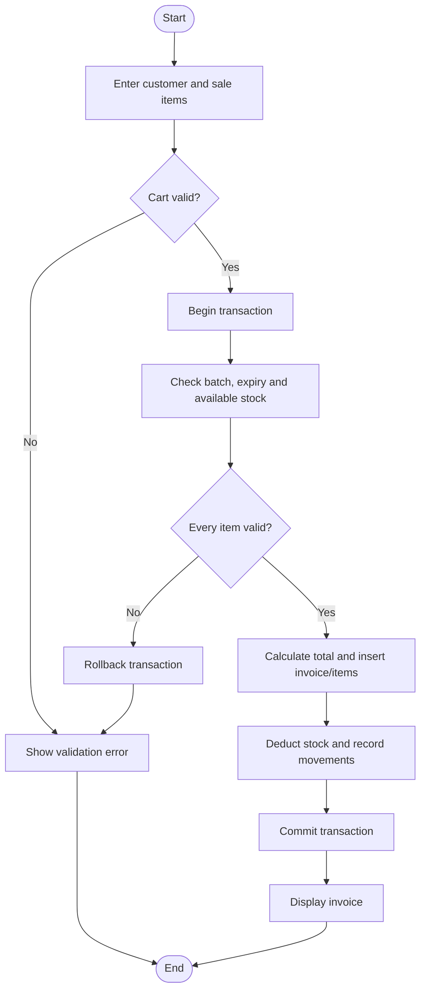

# Algorithms and flowcharts

## A. Sale / billing algorithm
1. Read customer (optional) and cart lines.
2. Validate that at least one line exists and every quantity is a positive integer.
3. Begin database transaction.
4. For each line, load the batch and medicine; reject unknown or expired batches and insufficient stock.
5. Calculate each line total and the bill total.
6. Insert sale header and item rows.
7. Decrement stock with a conditional update that cannot make quantity negative.
8. Insert a negative stock-movement record for each item.
9. Commit the transaction and show the invoice.
10. On any error, roll back all changes and show a validation message.

## B. Receive stock algorithm
1. Select medicine and optional supplier.
2. Validate batch number, future expiry, positive quantity and non-negative prices.
3. Begin transaction.
4. Insert a new batch or increase quantity for the same medicine/batch.
5. Insert purchase header and purchase-item details.
6. Insert a positive stock-movement record.
7. Commit; if a constraint fails, roll back.

## C. Low-stock report
1. Aggregate valid batch quantities by medicine.
2. Compare available quantity with each medicine's reorder level.
3. Display medicines where available stock is less than or equal to reorder level.
