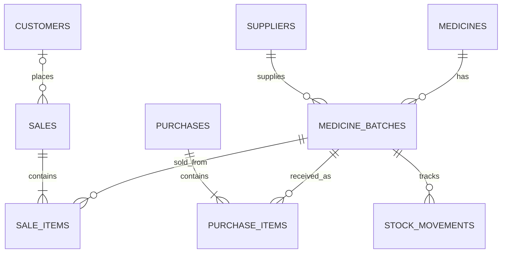

# DBMS design notes — Pharmacy Management System

## Main entities and relationships
- **Supplier (1) → (many) MedicineBatch**: a supplier can supply multiple batches.
- **Medicine (1) → (many) MedicineBatch**: one medicine may be stocked in multiple batches/expiry dates.
- **Customer (1) → (many) Sale**: customer is optional for walk-in sales.
- **Sale (1) → (many) SaleItem**: a bill contains one or more line items.
- **MedicineBatch (1) → (many) SaleItem/PurchaseItem**: sales and purchases reference exact batches.
- **StockMovement** records purchase, sale, and adjustment changes for traceability.

ER diagram in Mermaid:


## Normalization summary
- **1NF:** every field stores a single value; repeating sale/purchase items are in separate line-item tables.
- **2NF:** line-item facts (quantity, unit price) depend on the line-item primary key; descriptive medicine/customer/supplier fields are kept in their own tables.
- **3NF:** supplier, customer and medicine details are not duplicated into sales line items; non-key descriptive attributes depend on their table key. Batch-specific expiry and pricing belong to MedicineBatch.

## SQL concepts demonstrated
- DDL: `CREATE TABLE`, `CREATE INDEX`, `CREATE VIEW`.
- DML: `INSERT`, `SELECT`, `UPDATE`, `DELETE` (deletion is constrained by foreign-key relationships).
- Constraints: primary key, foreign key, NOT NULL, UNIQUE, CHECK, DEFAULT.
- Joins: sale items join batches and medicines; batch joins suppliers.
- Aggregates: `SUM`, `COUNT`, `MIN`, `GROUP BY`.
- Subqueries: low-stock and expiry reports can be written using nested SELECTs.
- Transactions: sale creation inserts a sale and line items, decrements stock and writes movement records atomically. An exception rolls the transaction back.
- Indexes: medicine name, batch expiry, medicine foreign key, and sale date.
- View examples: `v_inventory`, `v_low_stock`, `v_expiring_batches`.

## Example queries
```sql
-- 1. Inventory quantity by medicine
SELECT m.name, SUM(b.quantity) AS stock
FROM medicines m JOIN medicine_batches b ON b.medicine_id = m.medicine_id
GROUP BY m.medicine_id, m.name
ORDER BY m.name;

-- 2. Sales by day
SELECT date(sale_date) AS sale_day, SUM(total_amount) AS revenue
FROM sales GROUP BY date(sale_date) ORDER BY sale_day DESC;

-- 3. Medicines below reorder level
SELECT medicine_name, available_stock, reorder_level
FROM v_low_stock ORDER BY available_stock;

-- 4. Batch expiry report
SELECT medicine_name, batch_number, expiry_date, quantity
FROM v_expiring_batches ORDER BY expiry_date;

-- 5. Sales line-item detail (join)
SELECT s.invoice_number, s.sale_date, m.name, si.quantity, si.unit_price, si.line_total
FROM sale_items si
JOIN sales s ON s.sale_id = si.sale_id
JOIN medicine_batches b ON b.batch_id = si.batch_id
JOIN medicines m ON m.medicine_id = b.medicine_id
ORDER BY s.sale_date DESC;
```

## Algorithms
### Receive stock
1. Validate supplier, medicine, batch, expiry date, quantity and prices.
2. Start a database transaction.
3. Insert or update the medicine batch; add a purchase and purchase-item record.
4. Add a positive stock-movement record.
5. Commit; on error, roll back.

### Complete a sale
1. Validate a non-empty cart and positive quantities.
2. Start a transaction.
3. For each cart item, confirm the batch exists, is not expired, and has sufficient stock.
4. Calculate line totals and grand total.
5. Insert sale and sale-item rows; decrement batch stock; add negative stock-movement rows.
6. Commit only when all items succeed; otherwise roll back the entire sale.

## PL/SQL note
The application uses SQLite, which does not support Oracle PL/SQL procedures, cursors, or triggers in the same form as Oracle Database. Equivalent transactional logic is implemented in Python with SQL transactions, and the schema uses SQLite views and constraints. For an Oracle-specific submission, translate these operations into PL/SQL procedures/triggers and execute them in Oracle SQL Developer.
