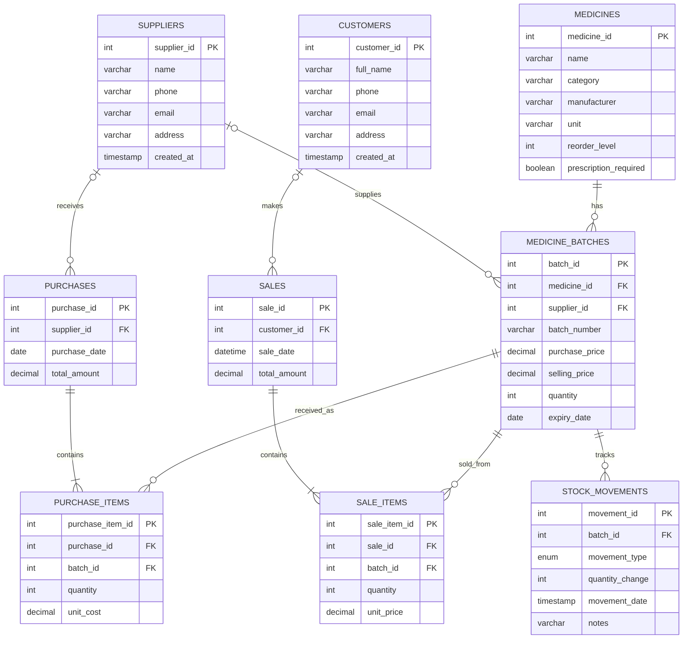

# MedCare Pharmacy — ER Diagram

This ER diagram is based on the current `database/medcare_mysql.sql` file in this repository. It represents the **classroom MySQL schema**; confirm separately if the deployed app uses a different schema.

## Relationship notes
- One medicine can have multiple batches; every batch references one medicine.
- A batch may reference a supplier; supplier is nullable in the SQL schema.
- A purchase may reference a supplier; the supplier reference is nullable.
- A purchase has one or more purchase-item rows; each purchase item references a purchase and a batch.
- A customer may have multiple sales; the customer reference on a sale is nullable.
- A sale has one or more sale-item rows; each sale item references a sale and a batch.
- Each stock movement references a batch.
- `v_inventory` and `v_low_stock` are **views**, not base tables, so they are not shown as entities here.

## Source
`database/medcare_mysql.sql` — repository schema file.