# MedCare Pharmacy ER Diagram — Chen Notation

This version follows the sample's classic Chen-style notation: rectangles for entities, ovals for attributes, diamonds for relationships, underlined primary-key attributes, and relationship cardinalities.

> Schema source: `database/medcare_mysql.sql`. The `v_inventory` and `v_low_stock` views are not shown as entities because they are database views, not base tables.

## Diagram

```mermaid
flowchart TB
  %% Entities
  SUP[SUPPLIERS]
  CUS[CUSTOMERS]
  MED[MEDICINES]
  BAT[MEDICINE_BATCHES]
  PUR[PURCHASES]
  PI[PURCHASE_ITEMS]
  SAL[SALES]
  SI[SALE_ITEMS]
  SM[STOCK_MOVEMENTS]

  %% Relationships (diamonds)
  R1{SUPPLIES}
  R2{PROVIDES}
  R3{HAS BATCHES}
  R4{CONTAINS}
  R5{RECEIVED AS}
  R6{MAKES}
  R7{CONTAINS}
  R8{SOLD FROM}
  R9{TRACKS}

  %% Relationship connections and cardinalities
  SUP ---|0..1 : 1..N| R1
  R1 --- BAT
  SUP ---|0..1 : 0..N| R2
  R2 --- PUR
  MED ---|1 : 0..N| R3
  R3 --- BAT
  PUR ---|1 : 1..N*| R4
  R4 --- PI
  BAT ---|1 : 0..N| R5
  R5 --- PI
  CUS ---|0..1 : 0..N| R6
  R6 --- SAL
  SAL ---|1 : 1..N*| R7
  R7 --- SI
  BAT ---|1 : 0..N| R8
  R8 --- SI
  BAT ---|1 : 0..N| R9
  R9 --- SM

  %% Attribute ovals
  SUP --- S1([<u>supplier_id</u>])
  SUP --- S2([name])
  SUP --- S3([phone])
  SUP --- S4([email])
  SUP --- S5([address])
  SUP --- S6([created_at])

  CUS --- C1([<u>customer_id</u>])
  CUS --- C2([full_name])
  CUS --- C3([phone])
  CUS --- C4([email])
  CUS --- C5([address])
  CUS --- C6([created_at])

  MED --- M1([<u>medicine_id</u>])
  MED --- M2([name])
  MED --- M3([category])
  MED --- M4([manufacturer])
  MED --- M5([unit])
  MED --- M6([reorder_level])
  MED --- M7([prescription_required])

  BAT --- B1([<u>batch_id</u>])
  BAT --- B2([medicine_id FK])
  BAT --- B3([supplier_id FK, nullable])
  BAT --- B4([batch_number])
  BAT --- B5([purchase_price])
  BAT --- B6([selling_price])
  BAT --- B7([quantity])
  BAT --- B8([expiry_date])

  PUR --- P1([<u>purchase_id</u>])
  PUR --- P2([supplier_id FK, nullable])
  PUR --- P3([purchase_date])
  PUR --- P4([total_amount])

  PI --- PI1([<u>purchase_item_id</u>])
  PI --- PI2([purchase_id FK])
  PI --- PI3([batch_id FK])
  PI --- PI4([quantity])
  PI --- PI5([unit_cost])

  SAL --- SA1([<u>sale_id</u>])
  SAL --- SA2([customer_id FK, nullable])
  SAL --- SA3([sale_date])
  SAL --- SA4([total_amount])

  SI --- SI1([<u>sale_item_id</u>])
  SI --- SI2([sale_id FK])
  SI --- SI3([batch_id FK])
  SI --- SI4([quantity])
  SI --- SI5([unit_price])

  SM --- SM1([<u>movement_id</u>])
  SM --- SM2([batch_id FK])
  SM --- SM3([movement_type])
  SM --- SM4([quantity_change])
  SM --- SM5([movement_date])
  SM --- SM6([notes])

  classDef entity fill:#cfe8c8,stroke:#333,color:#111,stroke-width:1.5px;
  classDef relationship fill:#f7e6b5,stroke:#333,color:#111,stroke-width:1.5px;
  classDef attribute fill:#e7f0d9,stroke:#333,color:#111;
  class SUP,CUS,MED,BAT,PUR,PI,SAL,SI,SM entity;
  class R1,R2,R3,R4,R5,R6,R7,R8,R9 relationship;
  class S1,S2,S3,S4,S5,S6,C1,C2,C3,C4,C5,C6,M1,M2,M3,M4,M5,M6,M7,B1,B2,B3,B4,B5,B6,B7,B8,P1,P2,P3,P4,PI1,PI2,PI3,PI4,PI5,SA1,SA2,SA3,SA4,SI1,SI2,SI3,SI4,SI5,SM1,SM2,SM3,SM4,SM5,SM6 attribute;
```

## Cardinality notes

- A medicine can have many batches; each batch belongs to one medicine.
- A supplier can be associated with many purchases and batches; the supplier foreign key is nullable in both places.
- A purchase has purchase-item rows, and each purchase item references one batch.
- A customer can have many sales; the customer reference on a sale is optional.
- A sale has sale-item rows, and each sale item references one batch.
- A batch can have many stock-movement records.
- The `1..N*` labels on purchase/sale line items indicate the intended business rule that a completed purchase or sale contains one or more items. The SQL foreign keys alone do not enforce a minimum number of child rows.

## Attribute conventions

- Underlined attribute names are primary keys.
- Attributes marked `FK` are foreign keys.
- `nullable` means the corresponding foreign key can be empty.
- This is a Chen-style teaching diagram expressed in Mermaid. Mermaid's oval nodes approximate attribute ovals; if a hand-drawn or report-ready image is required, use this as the source layout and redraw/export it in a diagram editor.
